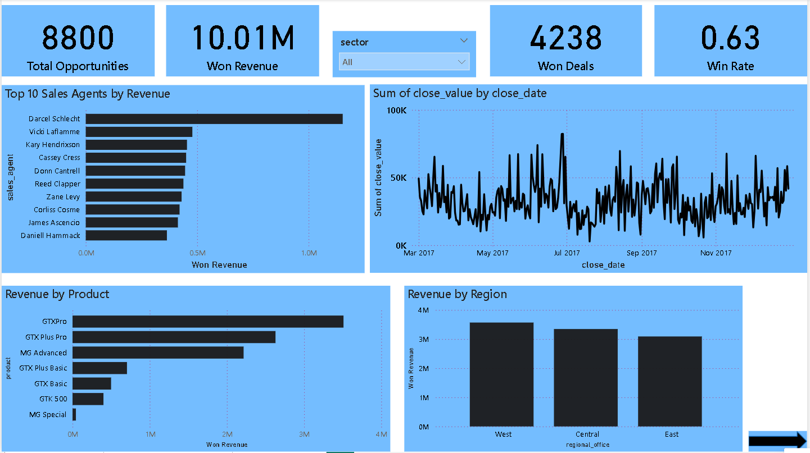
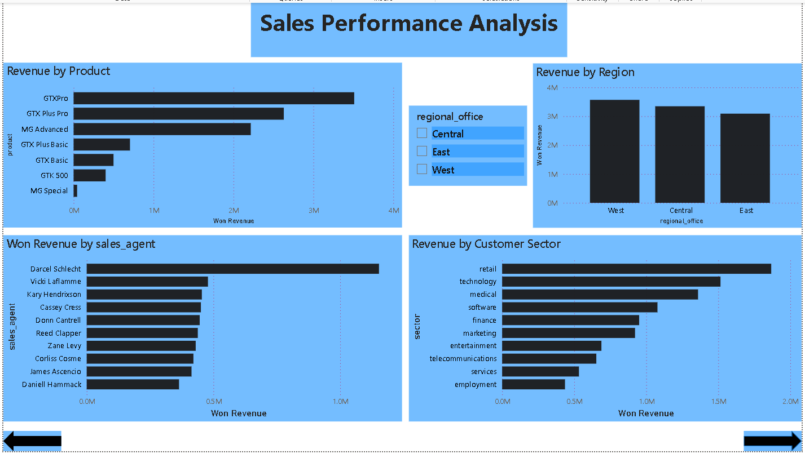
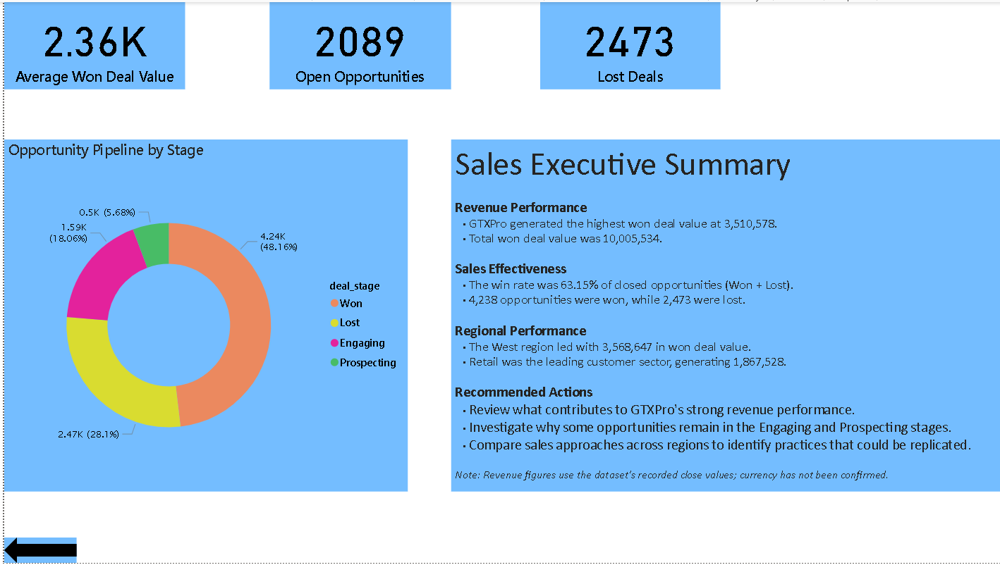

# AI-Powered Sales Analytics & Executive Reporting

An end-to-end sales analytics and business intelligence project that combines **Python, SQL Server, Power BI, and Gemini AI** to transform CRM sales opportunity data into actionable insights and executive-ready reporting.

The project covers data cleaning, SQL-based analysis, KPI calculation, interactive dashboard development, and AI-assisted report generation.

## Project Highlights

- Analyzed **8,800 sales opportunities** to evaluate sales pipeline performance.
- Calculated win rate, won and lost deals, and average won deal value.
- Used Python and Pandas for data inspection, cleaning, and KPI processing.
- Used SQL Server to store structured data and support analytical queries.
- Developed interactive Power BI dashboards for sales performance and executive insights.
- Integrated Gemini AI to generate a written executive report from calculated KPIs.

## Power BI Dashboard

The report contains three pages covering overall performance, detailed sales analysis, and executive insights.

### 1. Overall Sales Performance



### 2. Sales Performance Analysis



### 3. Executive Insights



## Key Business Metrics

| Metric | Result |
|---|---:|
| Total opportunities | 8,800 |
| Won deals | 4,238 |
| Lost deals | 2,473 |
| Engaging opportunities | 1,589 |
| Prospecting opportunities | 500 |
| Closed deals | 6,711 |
| Win rate | 63.15% |
| Total value of won deals | 10,005,534 |
| Average value per won deal | 2,360.91 |

**Metric definitions:**
- **Closed deals:** Won deals plus lost deals.
- **Win rate:** Won deals divided by the total of won and lost deals.
- **Average value per won deal:** Total value of won deals divided by the number of won deals.

*Note: The dataset's currency has not been confirmed. Monetary figures are therefore shown without a currency symbol. Metrics describe this dataset and should not be interpreted as current business results.*

## Tools & Technologies

- **Python:** Pandas, data cleaning, KPI calculations, JSON processing
- **SQL Server:** Relational data storage, SQL queries, aggregations, and sales analysis
- **Power BI:** Interactive dashboards, data modeling, DAX measures, and business reporting
- **Gemini AI API:** AI-assisted executive report generation
- **Git & GitHub:** Source code management and project documentation

## Project Structure

```text
├── data/
│   └── sales_kpis.json
├── python/
│   ├── clean_sales_data.py
│   ├── export_sales_kpis.py
│   ├── fetch_sales_kpis.py
│   ├── generate_ai_report.py
│   ├── inspect_dataset.py
│   ├── sales_kpi_analysis.py
│   ├── sales_performance_analysis.py
│   ├── test_gemini_api.py
│   └── test_sql_connection.py
├── reports/
│   └── Executive_Sales_Performance_Report.md
├── images/
│   ├── overall-sales-performance.png
│   ├── sales-performance-analysis.png
│   └── executive-insights.png
├── .gitignore
├── requirements.txt
└── README.md
```

**Dataset and Power BI file note:** The raw and cleaned datasets and the Power BI `.pbix` file are not included in this public repository. The report uses imported data, and redistribution permissions for the dataset have not been confirmed. Dashboard screenshots are provided to demonstrate the report's design and functionality.

## Dataset

This project uses the CRM Sales Opportunities dataset from Maven Analytics for sales pipeline and performance analysis.

The public repository excludes the raw and cleaned CSV files for licensing and redistribution considerations.

To reproduce the analysis:

1. Obtain the dataset from its original provider and follow the applicable terms of use.
2. Place the source CSV files in the `CRM+Sales+Opportunities/` directory.
3. Run the data-cleaning script to prepare the cleaned data.
4. Configure SQL Server and load the required cleaned tables.
5. Run the KPI and reporting scripts.

The source dataset is not distributed with this repository. The published KPI results and report are included for demonstration purposes.

## Project Workflow

1. **Data inspection:** Reviewed source files, column structures, missing values, and duplicate records.
2. **Data cleaning:** Standardized text fields, corrected the `technolgy` sector spelling to `technology`, parsed dates safely, and preserved missing values.
3. **SQL Server integration:** Stored cleaned data in relational tables for querying and analysis.
4. **KPI analysis:** Used Python and SQL to calculate sales performance metrics.
5. **Power BI visualization:** Developed report pages for overall sales performance, detailed analysis, and executive insights.
6. **AI-assisted reporting:** Integrated Gemini AI to generate written commentary from calculated KPI data.

## Data Quality Practices

- Checked opportunity identifiers for duplicate records.
- Corrected 12 occurrences of the `technolgy` sector spelling to `technology`.
- Converted date columns using safe date parsing.
- Preserved missing values rather than inventing dates or deal values.
- Documented metric definitions and the unconfirmed currency.
- Kept API credentials out of the source code.

## How to Run

### Prerequisites

- Python 3.11 or a compatible version
- Microsoft SQL Server and the appropriate ODBC driver
- Power BI Desktop for opening or rebuilding the dashboard
- A Gemini API key for AI-assisted report generation

### Setup

1. Clone or download this repository.
2. Open a terminal in the project directory.
3. Install dependencies:

   ```bash
   pip install -r requirements.txt
   ```

4. Obtain the source dataset from its original provider and place the CSV files in `CRM+Sales+Opportunities/`, using the filenames expected by the scripts.
5. Run the data-inspection and cleaning scripts.
6. Configure SQL Server and load the cleaned tables required by the analysis scripts.
7. Update the SQL Server instance name and connection settings in the scripts to match your environment.
8. Run the KPI calculation and export scripts.
9. Configure the Gemini API key if you want to generate the AI-assisted report.
10. Open or rebuild the Power BI report in Power BI Desktop using the prepared data.

**Important:** The Power BI `.pbix` file and source datasets are not included, so the report may need to be rebuilt locally. Follow the individual scripts' configuration and execution requirements.

### Gemini API Configuration

The AI reporting script reads the API key from an environment variable named `GEMINI_API_KEY`.

In Windows PowerShell, set it for the current terminal session:

```powershell
$env:GEMINI_API_KEY = "YOUR_GEMINI_API_KEY"
```

Replace the placeholder with your own key. Never commit real API keys, passwords, connection secrets, or `.env` files to GitHub.

## Limitations

- The results reflect the supplied dataset and do not guarantee future sales performance.
- The dataset's currency has not been confirmed.
- Missing data may affect particular analyses.
- AI-generated commentary may require human review and validation.
- Reproducing the project requires separately obtaining the dataset and configuring the local SQL Server environment.
- Dashboard screenshots are static; they do not provide the interactive filtering available in Power BI Desktop.

## Future Improvements

- Add automated data refresh and scheduled KPI reporting.
- Expand trend analysis and sales team performance comparisons.
- Add more validation checks and automated testing.
- Improve AI report validation and error handling.
- Publish an interactive dashboard through an appropriate sharing platform, subject to data licensing and access controls.

## Author

**Akash Patil**

- **GitHub:** https://github.com/AkashPatl28
- **LinkedIn:** https://linkedin.com/in/akash-patil-ap2842004
